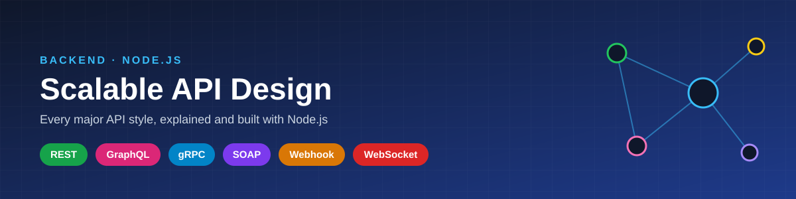
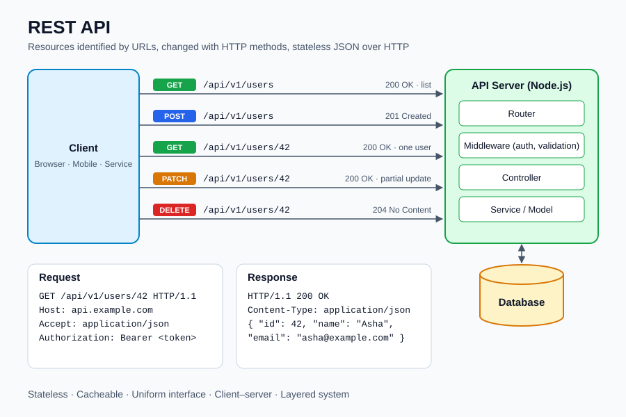
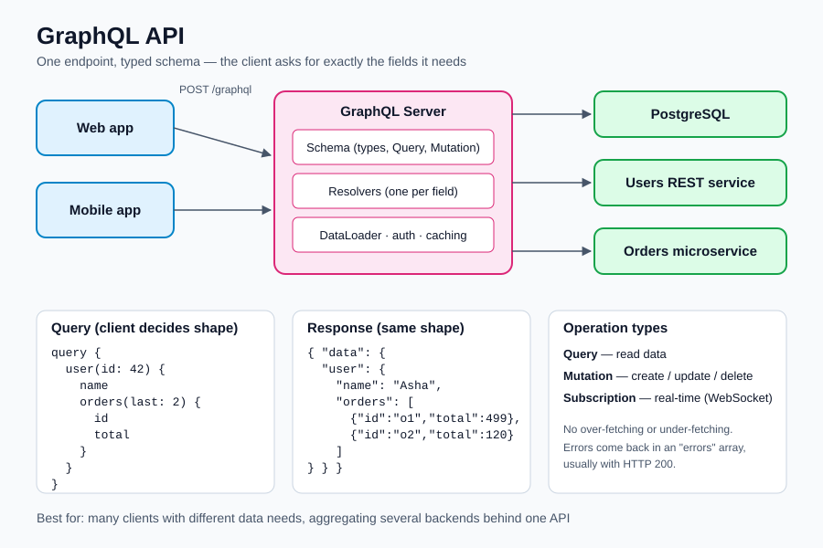
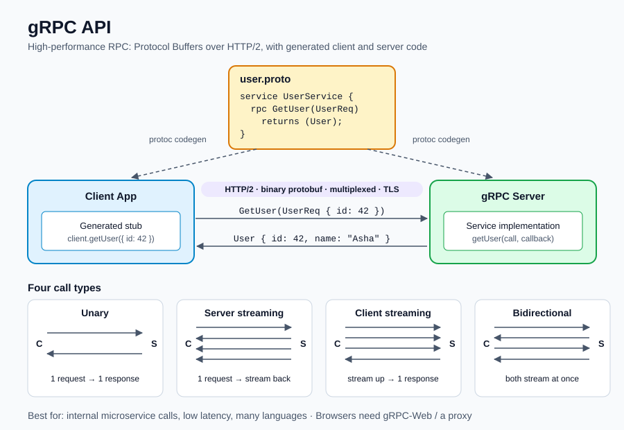
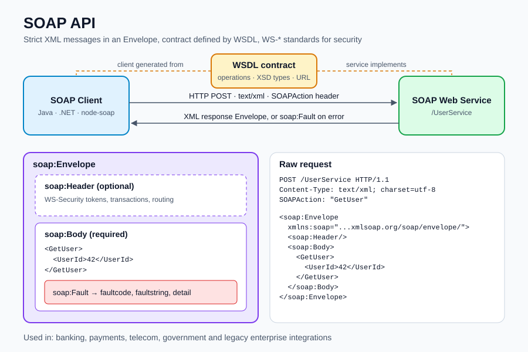
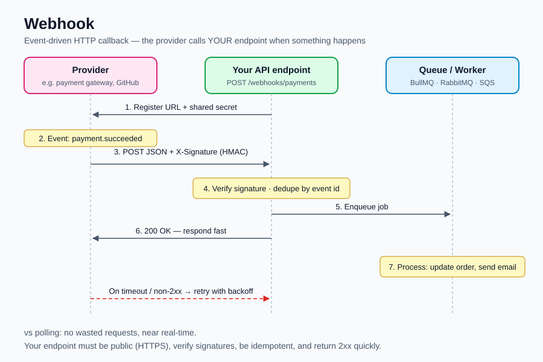
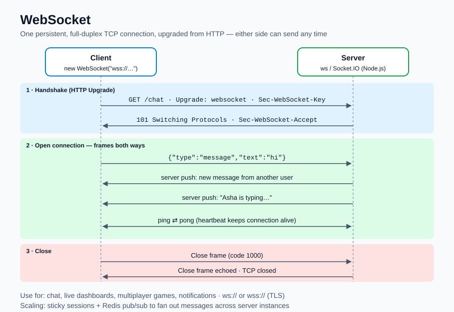

  

# Scalable API Design (Node.js)

Every major API style in one place: how each one works, when to use it, and a Node.js implementation in its own folder.

| API style | Folder | Best for |
|-----------|--------|----------|
| REST | [`rest-api/`](rest-api) | Public CRUD APIs, resource-based services |
| GraphQL | [`graphql/`](graphql) | Many clients with different data needs, combining several backends |
| gRPC | [`grpc/`](grpc) | Fast internal microservice calls |
| SOAP | [`soap/`](soap) | Banking, payments, legacy enterprise integrations |
| Webhook | [`webhook/`](webhook) | Event notifications from one system to another |
| WebSocket | [`websocket/`](websocket) | Real-time chat, live dashboards, multiplayer |

## REST API

Resources live at URLs (`/users/42`). HTTP methods (`GET`, `POST`, `PATCH`, `DELETE`) act on them, and status codes report the result. Stateless and cacheable.

## GraphQL

One endpoint (`POST /graphql`) and a typed schema. The client picks exactly the fields it needs, and resolvers fetch them from any data source.

## gRPC

A `.proto` file defines the service. Code is generated for client and server, and calls go over HTTP/2 as binary Protocol Buffers. Supports unary, server streaming, client streaming and bidirectional calls.

## SOAP

XML messages wrapped in an Envelope (an optional Header plus the Body), with the contract described in WSDL. Errors come back as `soap:Fault`.

## Webhook

The provider calls **your** endpoint when an event happens. Verify the signature, respond with `2xx` quickly, process the event in a background job, and handle retries idempotently.

## WebSocket

An HTTP `Upgrade` handshake opens one long-lived, full-duplex connection. The client and server can push messages to each other at any time.

## License

See [LICENSE](LICENSE).
