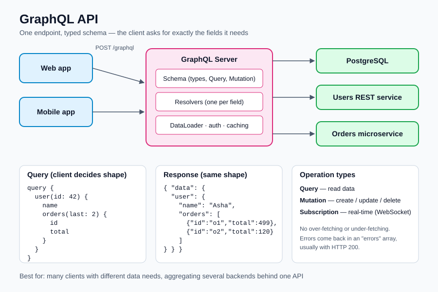

# GraphQL: Key Terminologies



**GraphQL** is a query language for APIs and a runtime for answering those queries, created at Facebook (2012, open-sourced 2015). The server publishes a **typed schema**; the client sends a query describing **exactly the data it wants**, often across several related objects, and gets back JSON in the same shape. Usually served from **one endpoint** (`POST /graphql`).

Working example: [README.md](README.md) (Blog API with Apollo Server, Express and MongoDB).

---

## 1. Core concepts

| Term | Meaning | Example |
|------|---------|---------|
| **Schema** | The typed contract of everything the API can do. | `type Post { title: String! }` |
| **SDL** | Schema Definition Language, the syntax schemas are written in. | `typeDefs.js` |
| **Operation** | One request: a query, mutation or subscription. | `query FeedPage { ... }` |
| **Query** | Read data. Fields can run in parallel. | `{ posts { title } }` |
| **Mutation** | Write data. Top-level fields run **in order**. | `createPost(input: {...})` |
| **Subscription** | Long-lived operation; the server pushes events (usually over WebSocket). | `commentAdded(postId: "1")` |
| **Resolver** | Function that returns the value of one field. | `Post.author` |
| **Selection set** | The fields the client asks for, inside `{ }`. | `{ id title }` |
| **Single endpoint** | All operations go to one URL; the query says what to do. | `/graphql` |

## 2. Type system

| Type | Meaning | Example |
|------|---------|---------|
| **Scalar** | Leaf value. Built-in: `Int`, `Float`, `String`, `Boolean`, `ID`. | `title: String` |
| **Custom scalar** | Your own leaf type with parse/serialize rules. | `scalar DateTime` |
| **Object type** | A type with fields. | `type Author { ... }` |
| **Non-null `!`** | Value can never be `null`. | `id: ID!` |
| **List `[ ]`** | An array. `[Post!]!` = non-null list of non-null posts. | `tags: [String!]!` |
| **Enum** | Fixed set of values. | `enum Role { ADMIN USER }` |
| **Input type** | Object type allowed as an argument (mutations). | `input CreatePostInput` |
| **Interface** | Fields shared by several types. | `interface Node { id: ID! }` |
| **Union** | One of several types, no shared fields required. | `union SearchResult = Post \| Author` |
| **Root types** | Entry points: `Query`, `Mutation`, `Subscription`. | `type Query { ... }` |
| **Description** | Docs string shown in tools. | `"Newest first"` |
| **Directive** | Annotation that changes behaviour. | `@deprecated(reason: "...")`, `@include(if: $x)`, `@skip` |

## 3. Writing operations

```graphql
query FeedPage($first: Int = 10, $withComments: Boolean!) {   # operation name + variables
  latest: posts(first: $first) {                              # alias "latest", argument
    edges {
      node {
        ...PostCard                                           # fragment spread
        comments @include(if: $withComments) { text }         # directive
      }
    }
  }
}

fragment PostCard on Post { id title author { name } }        # reusable fragment
```

| Term | Meaning |
|------|---------|
| **Arguments** | Inputs on any field: `posts(first: 10)`. |
| **Variables** | `$name` values sent separately as JSON. Never build queries with string concatenation. |
| **Alias** | Rename a field in the response, or fetch the same field twice with different args. |
| **Fragment** | Reusable set of fields. **Inline fragment** `... on Post { }` picks fields by concrete type. |
| **Operation name** | Names the operation for logs, metrics and caching. |
| **`__typename`** | Meta field returning the object's type name. |

## 4. Execution

| Term | Meaning |
|------|---------|
| **Parse → Validate → Execute** | Query text becomes an AST, is checked against the schema, then resolvers run. |
| **Resolver signature** | `(parent, args, context, info)`. |
| **parent** | Value returned by the parent field's resolver. |
| **args** | The field's arguments. |
| **context** | Per-request object shared by all resolvers: user, DataLoaders, DB. |
| **info** | Field name, path, AST, schema; used for advanced optimizations. |
| **Default resolver** | If no resolver is written, returns `parent[fieldName]`. |
| **Null propagation** | An error in a non-null field nulls its nearest nullable parent. |
| **Partial data** | A response may contain both `data` and `errors`. |

## 5. The N+1 problem and DataLoader

Listing 10 posts and each post's author naively runs **1 query for the posts + 10 for authors**. **DataLoader** collects every `.load(id)` in the same tick, calls a **batch function once** with all ids (`$in`), and caches results for that request.

Rules: create loaders **per request** (in context) so no data leaks between users; the batch function must return results **in the same order** as the keys.

## 6. Pagination

| Style | How | Notes |
|-------|-----|-------|
| **Offset** | `posts(limit: 10, offset: 20)` | Simple; slow for deep pages; items shift when new ones are added. |
| **Cursor (Relay connection)** | `posts(first: 10, after: "cursor")` → `edges { cursor node }`, `pageInfo { hasNextPage endCursor }` | Stable and fast; standard for GraphQL. |

## 7. Errors

```json
{ "data": { "post": null }, "errors": [{ "message": "...", "path": ["post"], "locations": [...], "extensions": { "code": "NOT_FOUND" } }] }
```

| Term | Meaning |
|------|---------|
| **`errors` array** | List of problems, with `message`, `path`, `locations`. |
| **`extensions.code`** | Machine-readable error code clients branch on (`BAD_USER_INPUT`, `UNAUTHENTICATED`, `FORBIDDEN`, `NOT_FOUND`, `INTERNAL_SERVER_ERROR` ...). |
| **HTTP status** | Parse/validation errors → `400`. Resolver errors usually still `200` (GraphQL-over-HTTP spec allows `application/graphql-response+json` with more precise codes). |
| **Errors as data** | Alternative: return a union like `CreatePostResult = Post \| ValidationError` so errors are typed in the schema. |
| **Error masking** | Never send internal messages / stack traces to clients in production. |

## 8. Subscriptions and real-time

| Term | Meaning |
|------|---------|
| **graphql-ws** | Modern WebSocket protocol for subscriptions (subprotocol `graphql-transport-ws`). |
| **subscriptions-transport-ws** | Old, unmaintained protocol. Do not use for new work. |
| **PubSub** | Event bus resolvers publish to and subscriptions listen on. In-memory for one instance; **Redis / Kafka** for many. |
| **withFilter** | Only deliver events matching the subscriber's arguments. |
| **SSE / `@defer` / `@stream`** | Other ways to stream results over HTTP. |

## 9. Schema design

| Practice | Meaning |
|----------|---------|
| **Schema-first vs code-first** | Write SDL then resolvers (this repo), or build the schema in code (Nexus, Pothos, TypeGraphQL). |
| **Evolve, do not version** | Add fields freely; mark old ones `@deprecated` and remove later, instead of `/v2`. |
| **Input + payload types** | `createPost(input: CreatePostInput!): CreatePostPayload!` keeps mutations extensible. |
| **Nullable by default** | Make fields nullable unless always present, so one failure does not null the whole response. |
| **Global object IDs** | `interface Node { id: ID! }` + `node(id:)` query (Relay). |
| **Federation / stitching** | Compose many services' schemas into one supergraph (Apollo Federation, GraphQL Mesh). |

## 10. Security and performance

| Risk / need | Defense |
|-------------|---------|
| Deeply nested queries | **Depth limit** (validation rule) |
| Huge / expensive queries | **Query cost / complexity** analysis; cap list sizes (`first ≤ 50`) |
| Batching attacks (many operations / aliases in one request) | Limit operations and aliases per request; rate limit |
| Schema discovery by attackers | Disable **introspection** in production (and field suggestions) |
| Only your own apps should call it | **Persisted queries / trusted documents**: server accepts only known query hashes |
| CSRF on simple requests | Require `Content-Type: application/json` or a preflight header (Apollo `csrfPrevention`) |
| Authorization | Check per field / per object in resolvers or directives, not only at the endpoint |
| Caching | No URL-based HTTP caching for POST; use APQ + GET, `@cacheControl`, CDN, or client caches (Apollo Client, Relay normalized cache) |
| Injection | Always use variables; typed args prevent passing raw query objects to the DB |

## 11. GraphQL vs REST vs gRPC

| | GraphQL | REST | gRPC |
|--|---------|------|------|
| Endpoints | One | One per resource | One per method |
| Data shape | Client decides | Server decides | Fixed by `.proto` |
| Over / under-fetching | Solved | Common | Fixed messages |
| Round trips for related data | One | Often several | Several |
| Schema / types | Required, introspectable | Optional (OpenAPI) | Required (`.proto`) |
| Versioning | Evolve + deprecate | `/v1`, `/v2` | Package versions |
| HTTP caching | Hard | Easy | No |
| Real-time | Subscriptions | SSE / WebSocket | Streaming |
| Best for | Many clients (web, mobile) with different needs, aggregating several backends | Public CRUD APIs | Fast internal service-to-service |

## 12. Tools and libraries

| Tool | Use |
|------|-----|
| **Apollo Server** | GraphQL server for Node. Used here. |
| **GraphQL Yoga**, **Mercurius**, **graphql-http** | Other Node servers. |
| **graphql-js** | Reference implementation everything builds on. |
| **DataLoader** | Batching + per-request caching. |
| **graphql-ws** | WebSocket subscriptions. |
| **Apollo Client**, **Relay**, **urql** | Front-end clients with normalized caches. |
| **GraphQL Code Generator** | Types for resolvers and clients from the schema. |
| **Apollo Sandbox**, **GraphiQL**, **Postman** | IDEs for exploring and running operations. |
| **Apollo Federation**, **GraphQL Mesh** | Compose multiple services into one graph. |

## 13. Best practices

- Design the schema around client needs, not database tables.
- Use DataLoader for every relationship field; create loaders per request.
- Paginate every list (cursor connections) and cap page sizes.
- Add depth/complexity limits; disable introspection in production; consider trusted documents.
- Return stable `extensions.code` values; mask internal errors.
- Authorize inside resolvers, per object.
- Deprecate instead of breaking; track field usage before removing.
- Name every operation and use variables, never string-built queries.
- Use a shared PubSub (Redis) when running more than one instance with subscriptions.
