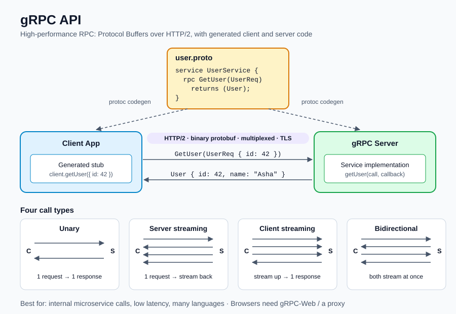

# gRPC: Key Terminologies



**gRPC** (originally from Google, now a CNCF project) is a high-performance **RPC (Remote Procedure Call)** framework. You define a service in a `.proto` file, generate (or load) client and server code for any language, and call remote methods as if they were local functions. Messages are binary **Protocol Buffers** sent over **HTTP/2**. It is the standard for fast internal microservice communication.

Working example: [README.md](README.md) (Inventory service with MongoDB and an Express REST gateway).

---

## 1. Core concepts

| Term | Meaning | Example |
|------|---------|---------|
| **RPC** | Calling a function that runs on another machine. | `client.GetProduct({ id })` |
| **Service** | A named group of RPC methods, defined in a `.proto`. | `InventoryService` |
| **Method / RPC** | One callable operation with a request and response type. | `rpc GetProduct(GetProductRequest) returns (Product)` |
| **Message** | A typed data structure (like a struct / DTO). | `message Product { ... }` |
| **Stub / Client** | Generated client object whose methods make the network calls. | `new InventoryService(target, creds)` |
| **Server** | Implements the service methods and listens on a port. | `grpc.Server` + `addService` |
| **Channel** | A long-lived HTTP/2 connection (pool) from client to server. Reused for every call. | One per target |
| **Target** | The server address the channel connects to. | `localhost:50051`, `dns:///inventory:50051` |
| **Contract-first** | The `.proto` is the source of truth; code follows it. | `proto/inventory.proto` |

## 2. Protocol Buffers (protobuf)

The **IDL** (Interface Definition Language) and the **binary serialization format** gRPC uses.

```proto
syntax = "proto3";
package inventory.v1;

message Product {
  string id = 1;          // field number 1
  int64 price_cents = 4;
  repeated string tags = 7; // a list
  optional string note = 8; // has presence (can tell "unset" from "")
}
```

| Term | Meaning |
|------|---------|
| **proto3** | Current syntax version. Every field is optional with a default (`0`, `""`, `false`). |
| **Field number** | The tag sent on the wire instead of the name. **Never change or reuse one.** |
| **`reserved`** | Blocks old field numbers/names after removing a field: `reserved 5; reserved "old_name";` |
| **Scalar types** | `string`, `bool`, `bytes`, `int32`, `int64`, `uint32`, `sint32`, `fixed64`, `float`, `double` ... |
| **`repeated`** | A list of values. |
| **`map<K, V>`** | A key/value map. |
| **`enum`** | Named constants. The first value must be `0` (the default), e.g. `UNKNOWN = 0`. |
| **`oneof`** | At most one of several fields is set. |
| **`optional`** | Adds presence tracking to a scalar field. |
| **Well-known types** | `google.protobuf.Timestamp`, `Duration`, `Empty`, `Struct`, wrappers (`StringValue` ...). |
| **package** | Namespace; put the version in it (`inventory.v1`) to allow breaking changes in `v2`. |
| **Wire format** | Compact binary: 3-10x smaller and much faster to parse than JSON. Not human-readable. |
| **protoc / buf** | Compilers that generate code from `.proto`. `buf` also lints and detects breaking changes. |
| **Static vs dynamic** | Generate code at build time (`protoc`, `ts-proto`) or load `.proto` at runtime (`@grpc/proto-loader`). |

### Safe vs breaking changes

| Safe ✅ | Breaking ❌ |
|---------|-------------|
| Add a new field (new number) | Change a field's number or type |
| Add a new RPC or message | Reuse a removed field number |
| Remove a field and `reserve` its number | Rename a package, service or RPC |
| Add an enum value | Change a unary RPC to streaming |

## 3. The four call types

| Type | Shape | Example use |
|------|-------|-------------|
| **Unary** | 1 request → 1 response | Get / create a record |
| **Server streaming** | 1 request → stream of responses | Large list, live price feed, log tail, AI token streaming |
| **Client streaming** | stream of requests → 1 response | File upload, bulk import, sensor batch |
| **Bidirectional streaming** | stream ↔ stream, independent | Chat, real-time sync, interactive processing |

```proto
rpc GetProduct(GetProductRequest) returns (Product);                // unary
rpc ListProducts(ListProductsRequest) returns (stream Product);     // server streaming
rpc ImportProducts(stream CreateProductRequest) returns (ImportSummary); // client streaming
rpc UpdateStock(stream StockChange) returns (stream StockLevel);    // bidirectional
```

## 4. HTTP/2 (the transport)

| Feature | Why it matters for gRPC |
|---------|-------------------------|
| **Multiplexing** | Many calls share one TCP connection at the same time, no head-of-line blocking at HTTP level. |
| **Streams** | Each RPC is one HTTP/2 stream; enables the streaming call types. |
| **Binary framing** | Efficient, matches binary protobuf. |
| **Header compression (HPACK)** | Small overhead for repeated metadata. |
| **Flow control** | Built-in backpressure per stream and connection. |
| **Trailers** | Headers sent **after** the body. gRPC puts the final `grpc-status` and `grpc-message` here. |

A gRPC request is an HTTP/2 `POST` to `/<package>.<Service>/<Method>` with `content-type: application/grpc`.

## 5. Metadata, deadlines, cancellation

| Term | Meaning |
|------|---------|
| **Metadata** | Key/value pairs sent with a call (like HTTP headers): auth tokens, request ids, tenant. Keys ending in `-bin` carry binary. |
| **Trailing metadata** | Metadata sent by the server at the end, with the status. |
| **Deadline** | An absolute time by which the call must finish. Set one on **every** call. Propagated to downstream calls. |
| **Timeout** | A relative deadline (e.g. 2 s). |
| **Cancellation** | Client cancels or the deadline passes → server sees `call.cancelled` and should stop working. |
| **Deadline propagation** | Pass the remaining deadline to the services you call, so the whole chain gives up together. |

## 6. Status codes

gRPC returns a status code instead of an HTTP code (HTTP is always `200`; the real status is in the trailers).

| Code | Name | Meaning | ~HTTP |
|:----:|------|---------|:-----:|
| 0 | `OK` | Success | 200 |
| 1 | `CANCELLED` | Caller cancelled | 499 |
| 2 | `UNKNOWN` | Unknown error | 500 |
| 3 | `INVALID_ARGUMENT` | Bad input | 400 |
| 4 | `DEADLINE_EXCEEDED` | Deadline passed | 504 |
| 5 | `NOT_FOUND` | Entity not found | 404 |
| 6 | `ALREADY_EXISTS` | Duplicate | 409 |
| 7 | `PERMISSION_DENIED` | Authenticated but not allowed | 403 |
| 8 | `RESOURCE_EXHAUSTED` | Quota / rate limit / too big | 429 |
| 9 | `FAILED_PRECONDITION` | System not in the required state | 400 |
| 10 | `ABORTED` | Concurrency conflict, retry at a higher level | 409 |
| 11 | `OUT_OF_RANGE` | Past the valid range | 400 |
| 12 | `UNIMPLEMENTED` | Method not implemented | 501 |
| 13 | `INTERNAL` | Server bug | 500 |
| 14 | `UNAVAILABLE` | Server down / overloaded. **Safe to retry** with backoff | 503 |
| 15 | `DATA_LOSS` | Unrecoverable data loss | 500 |
| 16 | `UNAUTHENTICATED` | Missing / invalid credentials | 401 |

**Rich error model:** `google.rpc.Status` with typed `details` (`BadRequest`, `ErrorInfo`, `RetryInfo`) sent in the `grpc-status-details-bin` trailer.

## 7. Security

| Term | Meaning |
|------|---------|
| **Insecure credentials** | Plaintext HTTP/2. Local dev only. |
| **TLS** | Encrypts the channel (`createSsl`). |
| **mTLS** | Both client and server present certificates. Common between microservices / in service meshes. |
| **Call credentials** | Per-call tokens (JWT / OAuth2) added as metadata. |
| **Interceptors** | Middleware around calls (client or server side): auth, logging, metrics, tracing, retries. |

## 8. Production features

| Feature | Meaning |
|---------|---------|
| **Health checking** | Standard `grpc.health.v1.Health` service; Kubernetes has native gRPC probes. |
| **Server reflection** | Lets tools (grpcurl, Postman) discover services without the `.proto`. |
| **Keepalive** | HTTP/2 pings that keep connections alive and detect dead peers. |
| **Retries / hedging** | Configured in the **service config**; retry only safe codes like `UNAVAILABLE`. |
| **Load balancing** | HTTP/2 connections are long-lived, so L4 balancers stick to one backend. Use **client-side LB** (`round_robin`, DNS / xDS) or an **L7 proxy / service mesh** (Envoy, Linkerd, Istio). |
| **Max message size** | Default 4 MB receive limit; stream large data instead of raising it. |
| **Compression** | gzip per message, opt-in. |
| **Graceful shutdown** | `tryShutdown` stops new calls and waits for in-flight ones. |

## 9. Browser and gateway options

Browsers cannot speak raw gRPC (no control over HTTP/2 trailers), so:

| Option | How |
|--------|-----|
| **gRPC-Web** | Special protocol + proxy (Envoy) between browser and server. |
| **Connect protocol** | Works over HTTP/1.1 and HTTP/2, browser-friendly, compatible with gRPC (`connectrpc`). |
| **REST gateway / transcoding** | HTTP/JSON → gRPC translation (grpc-gateway, Envoy transcoder, or a small Express app as in this repo). |

## 10. gRPC vs REST vs GraphQL

| | gRPC | REST | GraphQL |
|--|------|------|---------|
| Format | Protobuf (binary) | JSON (text) | JSON |
| Transport | HTTP/2 | HTTP/1.1 or 2 | HTTP |
| Contract | `.proto`, required | OpenAPI, optional | Schema, required |
| Code generation | Built in, many languages | Optional | Optional |
| Streaming | 4 types, native | No (use SSE / WebSocket) | Subscriptions |
| Browser support | Needs gRPC-Web / gateway | Native | Native |
| Payload size / speed | Smallest, fastest | Larger | Larger |
| Human-readable | No | Yes | Yes |
| HTTP caching | No | Yes | Hard |
| Best for | Internal microservices, low latency, polyglot, mobile ↔ backend | Public APIs, CRUD | Many clients with different data needs |

## 11. Tools

| Tool | Use |
|------|-----|
| **@grpc/grpc-js** | Official pure-JS gRPC for Node.js. Used here. |
| **@grpc/proto-loader** | Loads `.proto` at runtime. Used here. |
| **protoc**, **buf** | Code generation, linting, breaking-change detection. |
| **ts-proto**, **protobuf-es** | TypeScript types / code from `.proto`. |
| **grpcurl**, **grpcui** | `curl` and a web UI for gRPC. |
| **Postman**, **BloomRPC/Kreya** | GUI clients. |
| **Envoy** | Proxy: load balancing, gRPC-Web, JSON transcoding. |
| **grpc-health-probe** | CLI health probe for containers. |

## 12. Best practices

- Version packages (`myservice.v1`) and never change or reuse field numbers; run `buf breaking` in CI.
- Set a **deadline on every call** and propagate it downstream.
- Return the correct status code; never leak stack traces in `details`.
- Retry only idempotent calls and only on `UNAVAILABLE` (and maybe `DEADLINE_EXCEEDED`), with backoff.
- Reuse channels/clients; do not create one per request.
- Stream large results instead of huge unary responses; respect backpressure.
- Use TLS (mTLS inside the cluster) and send auth in metadata.
- Expose the health service; enable reflection only where safe.
- Use client-side load balancing or an L7 proxy, because HTTP/2 connections are long-lived.
- Keep the `.proto` files in a shared repo or registry (Buf Schema Registry) so every team builds from the same contract.
