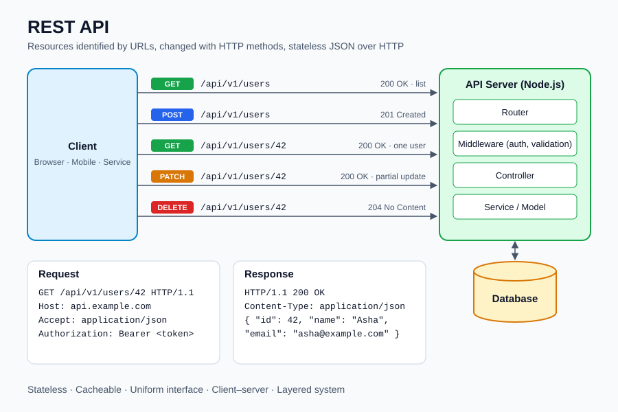

# REST API: Key Terminologies



**REST** (Representational State Transfer) is an architectural style, defined by Roy Fielding in 2000, for building APIs over HTTP. Resources live at URLs, HTTP methods act on them, and status codes report the result.

---

## 1. Core concepts

| Term | Meaning | Example |
|------|---------|---------|
| **Resource** | Any thing the API exposes: a user, an order, a file. | A user |
| **URI / Endpoint** | The address of a resource. | `/users/42` |
| **Collection** | A list of resources of one type. | `/users` |
| **Representation** | The format a resource is sent in (usually JSON). | `{ "id": 42, "name": "Asha" }` |
| **Client** | Whoever calls the API (browser, mobile app, another service). | React app |
| **Server** | Whoever owns the resources and answers requests. | Node.js / Express |
| **Request** | Method + URL + headers + optional body sent by the client. | `POST /users` |
| **Response** | Status code + headers + optional body sent back. | `201 Created` |

## 2. REST constraints (the 6 rules)

| Constraint | Meaning |
|------------|---------|
| **Client–Server** | UI and data storage are separated, so each can evolve on its own. |
| **Stateless** | Every request carries everything the server needs (e.g. the auth token). The server keeps no session between calls, which makes horizontal scaling easy. |
| **Cacheable** | Responses say whether they can be cached (`Cache-Control`, `ETag`). |
| **Uniform Interface** | Same rules everywhere: resources by URI, standard methods, self-descriptive messages, HATEOAS. |
| **Layered System** | The client cannot tell if it talks to the server directly or through a load balancer, CDN, or gateway. |
| **Code on Demand** *(optional)* | The server may send runnable code (e.g. JavaScript) to the client. |

> An API that follows all the required constraints is called **RESTful**.

## 3. HTTP methods

| Method | Purpose | Safe | Idempotent | Has body |
|--------|---------|:----:|:----------:|:--------:|
| `GET` | Read a resource or collection | ✅ | ✅ | ❌ |
| `POST` | Create a resource / run an action | ❌ | ❌ | ✅ |
| `PUT` | Replace a resource completely | ❌ | ✅ | ✅ |
| `PATCH` | Update part of a resource | ❌ | ❌* | ✅ |
| `DELETE` | Remove a resource | ❌ | ✅ | ❌ |
| `HEAD` | Same as `GET` but headers only | ✅ | ✅ | ❌ |
| `OPTIONS` | Ask which methods are allowed (used by CORS preflight) | ✅ | ✅ | ❌ |

- **Safe**: does not change server state.
- **Idempotent**: calling it once or N times leaves the server in the same state.
- \* `PATCH` can be made idempotent, but the spec does not guarantee it.

### CRUD mapping

| CRUD | Method | Route | Success code |
|------|--------|-------|--------------|
| Create | `POST` | `/users` | `201 Created` |
| Read all | `GET` | `/users` | `200 OK` |
| Read one | `GET` | `/users/:id` | `200 OK` |
| Replace | `PUT` | `/users/:id` | `200 OK` |
| Update | `PATCH` | `/users/:id` | `200 OK` |
| Delete | `DELETE` | `/users/:id` | `204 No Content` |

## 4. HTTP status codes

| Range | Class | Common codes |
|-------|-------|--------------|
| **1xx** | Informational | `100 Continue`, `101 Switching Protocols` |
| **2xx** | Success | `200 OK`, `201 Created`, `202 Accepted`, `204 No Content` |
| **3xx** | Redirection | `301 Moved Permanently`, `302 Found`, `304 Not Modified` |
| **4xx** | Client error | `400 Bad Request`, `401 Unauthorized`, `403 Forbidden`, `404 Not Found`, `405 Method Not Allowed`, `409 Conflict`, `415 Unsupported Media Type`, `422 Unprocessable Entity`, `429 Too Many Requests` |
| **5xx** | Server error | `500 Internal Server Error`, `502 Bad Gateway`, `503 Service Unavailable`, `504 Gateway Timeout` |

- **401 vs 403**: `401` = "who are you?" (not authenticated). `403` = "I know you, but you can't" (not authorized).
- **400 vs 422**: `400` = malformed request. `422` = well-formed but fails validation.

## 5. Parts of a request URL

```
https://api.example.com/v1/users/42/orders?status=paid&page=2#top
\___/   \_____________/\_/\_______________/\________________/
scheme       host     version   path          query string
```

| Term | Meaning | Example |
|------|---------|---------|
| **Base URL** | Root of the API. | `https://api.example.com/v1` |
| **Path parameter** | Identifies a specific resource. | `/users/:id` → `/users/42` |
| **Query parameter** | Filters, sorts, paginates. | `?status=paid&sort=-createdAt` |
| **Nested resource** | Resource that belongs to another. | `/users/42/orders` |

## 6. Headers

| Header | Direction | Purpose |
|--------|-----------|---------|
| `Content-Type` | Both | Format of the body (`application/json`). |
| `Accept` | Request | Format the client wants back. |
| `Authorization` | Request | Credentials (`Bearer <token>`). |
| `Cache-Control` | Response | Caching rules (`max-age=60`, `no-store`). |
| `ETag` | Response | Version fingerprint of a resource. |
| `If-None-Match` | Request | Send the `ETag` back; server replies `304` if unchanged. |
| `If-Match` | Request | Only update if the `ETag` still matches (optimistic locking). |
| `Location` | Response | URL of a newly created resource (with `201`). |
| `Retry-After` | Response | When to retry (with `429` / `503`). |
| `Idempotency-Key` | Request | Lets the server dedupe retried `POST`s. |
| `Access-Control-Allow-Origin` | Response | CORS: which origins may call the API. |

## 7. Design & naming conventions

- Use **nouns**, not verbs: `GET /users`, not `GET /getUsers`.
- Use **plural** collection names: `/users`, `/orders`.
- Use **lowercase** and **kebab-case**: `/order-items`.
- Let the **method** carry the action, not the URL.
- Keep nesting shallow (max ~2 levels): `/users/42/orders`, not `/users/42/orders/7/items/3/reviews`.
- Return consistent JSON shapes for both data and errors.

## 8. Scaling & production terms

| Term | Meaning |
|------|---------|
| **Versioning** | Change the API without breaking old clients: URI (`/v1/users`), header (`Accept: application/vnd.app.v2+json`), or query (`?version=2`). |
| **Pagination** | Return large collections in pages. **Offset** (`?page=2&limit=20`) is simple; **cursor** (`?cursor=abc&limit=20`) is stable and fast on large tables. |
| **Filtering** | Narrow results: `?status=active`. |
| **Sorting** | Order results: `?sort=-createdAt` (`-` = descending). |
| **Field selection** | Return only some fields: `?fields=id,name`. |
| **Rate limiting** | Cap requests per client per time window; reply `429` when exceeded. |
| **Throttling** | Slow requests down instead of rejecting them. |
| **Caching** | Store responses at client, CDN, or server (e.g. Redis) to cut load and latency. |
| **Idempotency key** | Unique key per operation so a retried `POST` (e.g. a payment) runs once. |
| **Content negotiation** | Client and server agree on format via `Accept` / `Content-Type`. |
| **Compression** | Shrink responses with `gzip` / `br` (`Content-Encoding`). |
| **API Gateway** | Single entry point that handles routing, auth, rate limiting, and logging. |
| **Load balancer** | Spreads traffic across many stateless server instances. |
| **Timeout** | Max time to wait for a response before failing. |
| **Retry with backoff** | Retry failed calls with growing delays (plus jitter). |
| **Circuit breaker** | Stop calling a failing downstream service for a while so it can recover. |

## 9. Security terms

| Term | Meaning |
|------|---------|
| **Authentication** | Proving who the caller is. |
| **Authorization** | Deciding what the caller may do. |
| **API key** | Static secret that identifies a client app. |
| **JWT** (JSON Web Token) | Signed token holding claims (`header.payload.signature`); verified without a DB lookup. |
| **Access / Refresh token** | Short-lived token for calls; long-lived token to get new access tokens. |
| **OAuth 2.0** | Standard for delegated access (e.g. "Login with Google"). |
| **HTTPS / TLS** | Encrypts traffic; mandatory for any real API. |
| **CORS** | Browser rule controlling which other origins may call your API. |
| **Input validation** | Reject bad input at the boundary (e.g. with Joi / Zod). |
| **RBAC** | Role-Based Access Control: permissions by role (`admin`, `user`). |

## 10. Advanced terms

| Term | Meaning |
|------|---------|
| **HATEOAS** | Hypermedia As The Engine Of Application State: responses include links to next possible actions. |
| **Richardson Maturity Model** | Levels of "RESTfulness": L0 one endpoint (RPC), L1 resources, L2 HTTP methods + status codes, L3 HATEOAS. |
| **OpenAPI / Swagger** | Standard YAML/JSON spec describing endpoints, inputs, and outputs; generates docs, clients, and mocks. |
| **Problem Details** (RFC 9457) | Standard error body: `type`, `title`, `status`, `detail`, `instance`. |
| **Optimistic locking** | Prevent lost updates with `ETag` + `If-Match`; reply `412 Precondition Failed` on mismatch. |
| **Long-running operation** | Reply `202 Accepted` with a status URL the client can poll. |
| **Bulk / batch endpoint** | Create or update many resources in one call. |
| **Soft delete** | Mark a record deleted instead of removing it. |

## 11. Example: request & response

**Request**

```http
POST /v1/users HTTP/1.1
Host: api.example.com
Content-Type: application/json
Authorization: Bearer eyJhbGciOi...

{ "name": "Asha", "email": "asha@example.com" }
```

**Success response**

```http
HTTP/1.1 201 Created
Content-Type: application/json
Location: /v1/users/42

{ "id": 42, "name": "Asha", "email": "asha@example.com" }
```

**Error response** (Problem Details)

```http
HTTP/1.1 422 Unprocessable Entity
Content-Type: application/problem+json

{
  "type": "https://api.example.com/errors/validation",
  "title": "Validation failed",
  "status": 422,
  "detail": "email must be a valid email address"
}
```

## 12. REST vs other styles (quick view)

| | REST | GraphQL | gRPC |
|--|------|---------|------|
| Endpoints | Many (one per resource) | One (`/graphql`) | Service methods |
| Format | JSON (usually) | JSON | Protocol Buffers (binary) |
| Transport | HTTP/1.1 or HTTP/2 | HTTP | HTTP/2 |
| Over/under-fetching | Possible | Avoided | Avoided (fixed messages) |
| HTTP caching | Built in | Hard | Not used |
| Best for | Public CRUD APIs | Flexible client data needs | Fast internal service calls |
