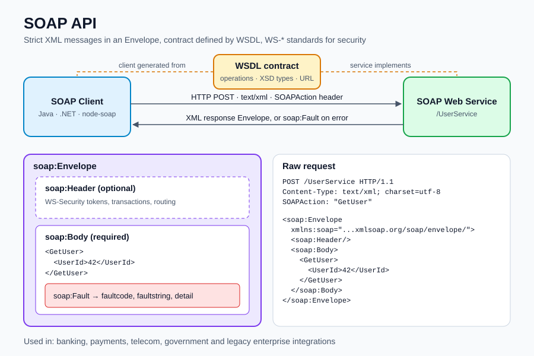

# SOAP: Key Terminologies



**SOAP** (originally Simple Object Access Protocol) is a W3C **protocol** for exchanging structured XML messages between systems. Unlike REST (an architectural style), SOAP has a strict standard: every message is an XML **Envelope**, and the service's operations and data types are described up front in a **WSDL** contract. Still widely used in banking, payments, insurance, telecom and government integrations.

Working example: [README.md](README.md) (Bank Accounts service with Express + MongoDB).

---

## 1. Core concepts

| Term | Meaning | Example |
|------|---------|---------|
| **Web service** | A program that exposes operations over a network using SOAP messages. | `BankService` |
| **Operation** | One callable action, like a function. | `Deposit`, `Withdraw` |
| **Message** | The XML sent in (request) or out (response/fault). | `DepositRequest` |
| **Endpoint** | The single URL the service listens on. Every operation uses it. | `POST /soap/bank` |
| **Contract-first** | Write the WSDL/XSD first, then generate or write code that fits it. | `bank.wsdl` |
| **Consumer / Provider** | The client calling the service / the server implementing it. | Payment gateway / bank |

## 2. Message structure

```xml
<soap:Envelope xmlns:soap="http://schemas.xmlsoap.org/soap/envelope/">
  <soap:Header>   <!-- optional: auth, transaction id, routing -->
    <wsse:Security>...</wsse:Security>
  </soap:Header>
  <soap:Body>     <!-- required: the actual request or response -->
    <bank:DepositRequest>...</bank:DepositRequest>
  </soap:Body>
</soap:Envelope>
```

| Part | Required | Purpose |
|------|:--------:|---------|
| **Envelope** | ✅ | Root element. Marks the XML as a SOAP message and sets the version via namespace. |
| **Header** | ❌ | Metadata that is not business data: security tokens, correlation ids, transactions. |
| **Header block** | ❌ | One child of Header. Can have `mustUnderstand="1"`: the receiver must process it or return a fault. |
| **Body** | ✅ | The payload: the operation request, its response, or a Fault. |
| **Fault** | ❌ | Lives inside Body when something went wrong. Replaces the normal response. |

## 3. WSDL (Web Services Description Language)

An XML file that is the **contract** of the service. Tools (SoapUI, Postman, `wsimport`, `svcutil`, node-soap) read it and generate clients. Usually served at `?wsdl`.

| WSDL 1.1 section | What it describes | Analogy |
|------------------|-------------------|---------|
| `<types>` | Data types, written in **XSD** | Type definitions / DTOs |
| `<message>` | The data in one direction (input, output, fault) | Function args / return value |
| `<portType>` | Abstract list of operations | An interface |
| `<binding>` | How the interface is sent: SOAP version, style, encoding, `soapAction` | The wire protocol |
| `<service>` / `<port>` | Where it lives: the endpoint URL | Base URL |

**WSDL 2.0** renames `portType` → `interface` and `port` → `endpoint`, but 1.1 is still what almost everyone uses.

## 4. XSD (XML Schema Definition)

Defines the shape and rules of each XML element: `xsd:string`, `xsd:int`, `xsd:decimal`, `xsd:dateTime`, `xsd:boolean`, plus `minOccurs`, `maxOccurs`, `pattern`, `enumeration`, `complexType`, `sequence`. Both sides can validate messages against it before any business code runs.

| Term | Meaning |
|------|---------|
| **Namespace** | A URI that makes element names unique, e.g. `http://example.com/bank`. |
| **targetNamespace** | The namespace the schema / WSDL defines its names in. |
| **Prefix** | Short alias for a namespace: `soap:`, `xsd:`, `tns:` (this namespace). |
| **complexType** | An element with child elements (an object). |
| **simpleType** | A restricted primitive, e.g. a 10-digit string. |

## 5. Styles and encodings

| Combination | Notes |
|-------------|-------|
| **Document / literal** | Body holds an XML document that matches the XSD exactly. Recommended. WS-I Basic Profile compliant. |
| **Document / literal wrapped** | Document/literal where the Body element is named after the operation. Most common in practice. |
| **RPC / literal** | Body element named after the operation, parts as children. Fine, less common. |
| **RPC / encoded** | Adds SOAP encoding type info (`xsi:type`). Legacy, not WS-I compliant. Avoid. |

## 6. SOAP 1.1 vs SOAP 1.2

| | SOAP 1.1 | SOAP 1.2 |
|--|----------|----------|
| Envelope namespace | `http://schemas.xmlsoap.org/soap/envelope/` | `http://www.w3.org/2003/05/soap-envelope` |
| Content-Type | `text/xml` | `application/soap+xml` |
| Operation hint | `SOAPAction` HTTP header | `action` parameter of the Content-Type |
| Fault codes | `Client`, `Server`, `VersionMismatch`, `MustUnderstand` | `Sender`, `Receiver`, `VersionMismatch`, `MustUnderstand`, `DataEncodingUnknown` |
| Fault fields | `faultcode`, `faultstring`, `faultactor`, `detail` | `Code/Value`, `Reason/Text`, `Node`, `Role`, `Detail` |
| HTTP status on fault | `500` | `400` for Sender, `500` for Receiver |

## 7. Faults (error handling)

```xml
<soap:Fault>
  <faultcode>soap:Client</faultcode>
  <faultstring>Balance is lower than the amount requested</faultstring>
  <detail><BankFault><code>INSUFFICIENT_FUNDS</code></BankFault></detail>
</soap:Fault>
```

| Fault code (1.1) | Meaning | Retry? |
|------------------|---------|--------|
| `Client` | The request is wrong (bad data, not found, business rule). | No, fix the request |
| `Server` | The service failed (DB down, bug). | Yes, later |
| `VersionMismatch` | Unknown Envelope namespace. | No |
| `MustUnderstand` | A `mustUnderstand="1"` header was not processed. | No |

Put a typed, machine-readable error in `detail` (declared as a `<fault>` in the WSDL) so clients can branch on a code, not on text.

## 8. WS-* standards

| Standard | Purpose |
|----------|---------|
| **WS-Security** | Message-level security: `UsernameToken`, X.509 signatures, XML Encryption, timestamps. Survives intermediaries, unlike TLS alone. |
| **WS-Addressing** | Routing info (`To`, `Action`, `MessageID`, `ReplyTo`) inside the Header. Enables async replies. |
| **WS-ReliableMessaging** | Guaranteed, in-order, exactly-once delivery. |
| **WS-AtomicTransaction** | Distributed transactions across services (2-phase commit). |
| **WS-Policy** | Declares in the WSDL what a service requires (e.g. signed messages). |
| **MTOM** | Sends binary attachments efficiently instead of base64 in the XML. |
| **WS-I Basic Profile** | Interoperability rules so .NET, Java and Node clients agree. |

## 9. Transport

SOAP is transport-independent, but HTTP `POST` is used almost everywhere. Also possible: SMTP, JMS / message queues, TCP. The endpoint URL never changes per operation, so HTTP caching does not apply.

## 10. SOAP vs REST

| | SOAP | REST |
|--|------|------|
| Type | Protocol (strict standard) | Architectural style |
| Format | XML only | JSON (usually), XML, anything |
| Contract | WSDL + XSD, required | OpenAPI, optional |
| Endpoint | One URL, operation in the Body | One URL per resource, method = action |
| Errors | `soap:Fault` | HTTP status codes |
| Security | WS-Security (message level) + TLS | TLS + OAuth2 / JWT |
| Transactions / reliability | Built-in standards (WS-AT, WS-RM) | Build it yourself |
| Caching | No | HTTP caching |
| Payload size / speed | Heavier, slower to parse | Lighter, faster |
| Best for | Banking, payments, telecom, government, legacy enterprise | Public web / mobile APIs |

## 11. Tools

| Tool | Use |
|------|-----|
| **SoapUI** | Import a WSDL, send requests, mock services, load test. |
| **Postman** | Send raw envelopes; can import a WSDL. |
| **node-soap** (`soap` on npm) | SOAP client and server for Node.js. Used in this repo. |
| **wsimport / JAX-WS**, **Apache CXF** | Java code generation and servers. |
| **svcutil / WCF / CoreWCF** | .NET clients and services. |
| **zeep** | Python SOAP client. |

## 12. Best practices

- Write the WSDL first and version it (new namespace or new operation for breaking changes).
- Use **document/literal (wrapped)**; avoid RPC/encoded.
- Return typed faults with a code in `detail`; never put stack traces in `faultstring`.
- Validate input at the boundary (XSD patterns and in code); never trust the client.
- Use TLS always; add WS-Security when messages pass through intermediaries or need signing.
- Limit request body size and use an XML parser with external entities disabled (prevents **XXE** and "billion laughs" attacks).
- Store money as integers (minor units) or decimals, never floats.
- Make money-moving operations idempotent (client sends a unique request id) and atomic.
- Log the raw envelope only after masking secrets and personal data.
