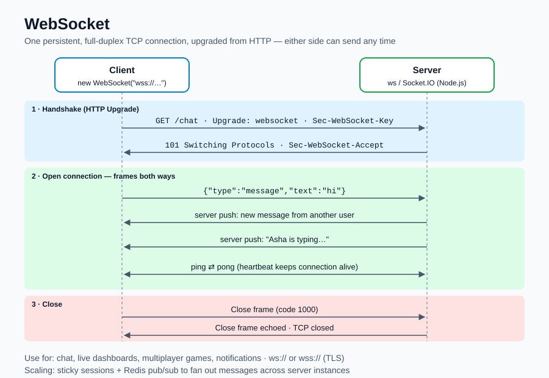

# WebSocket: Key Terminologies



**WebSocket** (RFC 6455) is a protocol that opens **one long-lived, full-duplex TCP connection** between a client and a server. After an HTTP handshake, either side can send messages at any time, with no new request per message. It powers chat, live dashboards, multiplayer games, collaborative editors, trading tickers and notifications.

Working example: [README.md](README.md) (chat rooms with Express, `ws` and MongoDB).

---

## 1. Core concepts

| Term | Meaning | Example |
|------|---------|---------|
| **Full-duplex** | Both sides can send at the same time on one connection. | Server pushes a message while the client types |
| **Persistent connection** | Stays open until one side closes it. No reconnect per message. | One socket for the whole session |
| **Server push** | The server sends data without the client asking first. | New chat message arrives |
| **Real-time** | Updates arrive in milliseconds, not on the next poll. | Live score |
| **Stateful** | The server remembers each open connection (who, which room). | `rooms` map in `chat.js` |
| **Endpoint** | The URL the socket connects to. | `ws://localhost:3000/ws` |

## 2. URL schemes

| Scheme | Port | Meaning |
|--------|------|---------|
| `ws://` | 80 | Plain WebSocket (like `http://`). Dev only. |
| `wss://` | 443 | WebSocket over TLS (like `https://`). Always use in production. |

## 3. Handshake (opening the connection)

The client sends a normal HTTP/1.1 `GET` asking to switch protocols:

```http
GET /ws HTTP/1.1
Host: localhost:3000
Upgrade: websocket
Connection: Upgrade
Sec-WebSocket-Key: dGhlIHNhbXBsZSBub25jZQ==
Sec-WebSocket-Version: 13
Origin: http://localhost:3000
```

The server agrees with **`101 Switching Protocols`**:

```http
HTTP/1.1 101 Switching Protocols
Upgrade: websocket
Connection: Upgrade
Sec-WebSocket-Accept: s3pPLMBiTxaQ9kYGzzhZRbK+xOo=
```

| Header | Purpose |
|--------|---------|
| `Upgrade: websocket` / `Connection: Upgrade` | Ask to switch from HTTP to WebSocket |
| `Sec-WebSocket-Key` | Random value from the client |
| `Sec-WebSocket-Accept` | Base64(SHA-1(key + fixed GUID)). Proves the server speaks WebSocket. Not security. |
| `Sec-WebSocket-Version` | Always `13` |
| `Sec-WebSocket-Protocol` | Optional **subprotocol** negotiation (e.g. `graphql-ws`, `mqtt`) |
| `Sec-WebSocket-Extensions` | Optional extensions, e.g. `permessage-deflate` (compression) |
| `Origin` | The page's site. The server must check it (see Security). |

After `101`, the TCP connection carries WebSocket **frames**, not HTTP.

## 4. Frames

| Term | Meaning |
|------|---------|
| **Frame** | The unit on the wire: a small header + payload. |
| **Message** | One or more frames (fragmentation) that form one logical message. |
| **Opcode** | Frame type, see below. |
| **FIN bit** | Marks the last frame of a message. |
| **Masking** | Client→server frames are XOR-masked with a random key (prevents cache poisoning of proxies). Server→client frames are not. |
| **Payload length** | 7 bits, or 16 / 64-bit extended. Servers set a max (`maxPayload`). |

| Opcode | Type | Use |
|--------|------|-----|
| `0x1` | Text | UTF-8 text, usually JSON |
| `0x2` | Binary | Images, audio, Protobuf, MessagePack |
| `0x0` | Continuation | Next fragment of a message |
| `0x8` | Close | Start or confirm closing, with a code + reason |
| `0x9` | Ping | "Are you alive?" |
| `0xA` | Pong | "Yes" (automatic reply to ping) |

## 5. Lifecycle and events

| Browser API | `ws` (Node) | When |
|-------------|-------------|------|
| `onopen` | `'open'` / server `'connection'` | Handshake finished |
| `onmessage` | `'message'` | A message arrived |
| `onerror` | `'error'` | Something failed (always followed by close) |
| `onclose` | `'close'` | Connection closed, with a code |
| `send(data)` | `ws.send(data)` | Send text or binary |
| `close(code, reason)` | `ws.close()` / `ws.terminate()` | Polite close / kill the socket now |
| `readyState` | `readyState` | `0` CONNECTING, `1` OPEN, `2` CLOSING, `3` CLOSED |
| `bufferedAmount` | `bufferedAmount` | Bytes queued but not yet sent |

## 6. Close codes

| Code | Meaning |
|------|---------|
| `1000` | Normal closure |
| `1001` | Going away (server restart, page closed) |
| `1002` | Protocol error |
| `1003` | Unsupported data type |
| `1006` | Abnormal closure: dropped without a close frame (never sent on the wire) |
| `1008` | Policy violation (e.g. auth failed) |
| `1009` | Message too big |
| `1011` | Internal server error |
| `4000–4999` | Free for your application |

## 7. Heartbeat (ping/pong)

TCP does not notice a dead peer quickly (laptop closed, Wi-Fi gone). The server pings every client every N seconds; a client that has not ponged by the next round is **terminated** and its resources freed. This also keeps proxies and load balancers from closing idle connections.

## 8. Application-level patterns

| Pattern | Meaning |
|---------|---------|
| **Message protocol** | WebSocket only moves bytes. You define the format, usually JSON with a `type` field. |
| **Rooms / channels / topics** | Groups of sockets that receive the same broadcasts. |
| **Broadcast** | Send one message to every socket in a room. |
| **Presence** | Who is online right now, updated on join/leave. |
| **Acknowledgement (ack)** | The receiver confirms a message, so the sender can retry. |
| **Reconnect with backoff + jitter** | After a drop, retry after 0.5 s, 1 s, 2 s ... capped, with randomness so clients do not reconnect all at once (thundering herd). |
| **Resume / catch-up** | On reconnect, fetch what was missed (e.g. "messages after id X") via REST. |
| **Backpressure** | If a client reads slowly, `bufferedAmount` grows; drop, skip or disconnect it instead of using unlimited memory. |
| **Rate limiting** | Cap frames per second per socket. |

## 9. Scaling WebSockets

| Problem | Solution |
|---------|----------|
| Each server only knows its own sockets | **Pub/sub backplane**: Redis pub/sub, NATS, Kafka. Every instance publishes events and forwards received ones to its own clients. |
| Load balancer must support long connections | Enable WebSocket / `Upgrade` support; raise idle timeout above the heartbeat interval. |
| Sticky sessions | Needed only for transports with fallbacks (Socket.IO long-polling) or in-memory state; not needed with a pub/sub backplane. |
| Many idle connections | Raise file-descriptor limits; one Node process can hold tens of thousands of sockets. |
| Deploys drop everyone | Close with `1001`, clients reconnect with backoff to healthy instances. |
| Managed options | AWS API Gateway WebSockets, Azure Web PubSub, Ably, Pusher. |

## 10. Security

| Risk | Defense |
|------|---------|
| **Cross-Site WebSocket Hijacking (CSWSH)**: a malicious site opens a socket with the user's cookies | Check `Origin` against an allow-list in the handshake; prefer token auth over cookies |
| Unauthenticated sockets | Authenticate during the handshake or in the first message (JWT / short-lived ticket); close with `1008` if invalid |
| Tokens in URLs end up in logs | Use a short-lived, single-use ticket if a URL token is unavoidable |
| Huge frames / memory exhaustion | `maxPayload`, rate limits, backpressure |
| Untrusted input | Validate every message like a request body; whitelist `type` values |
| XSS in chat text | Render with `textContent`, never `innerHTML` |
| Sniffing | Always `wss://` in production |

## 11. WebSocket vs alternatives

| | WebSocket | Server-Sent Events (SSE) | Long polling | HTTP polling | WebTransport |
|--|-----------|--------------------------|--------------|--------------|--------------|
| Direction | Both ways | Server → client | Server → client (emulated) | Client asks | Both ways |
| Transport | TCP (after HTTP upgrade) | HTTP | HTTP | HTTP | HTTP/3 (QUIC) |
| Latency | Very low | Low | Medium | High | Very low |
| Auto-reconnect | Build it | Built in | Build it | n/a | Build it |
| Binary | Yes | No (text) | Yes | Yes | Yes |
| Best for | Chat, games, collaboration | Notifications, feeds, AI token streaming | Old environments | Rarely-changing data | Games, media (newer) |

## 12. Libraries (Node.js)

| Library | Notes |
|---------|-------|
| **ws** | Fast, minimal, standards-only. Used in this repo. |
| **Socket.IO** | Adds rooms, acks, auto-reconnect, fallbacks and a Redis adapter. Has its own protocol: a plain WebSocket client cannot talk to it. |
| **uWebSockets.js** | Very high performance, C++ core. |
| Browser | Built-in `WebSocket` API, no library needed. |

## 13. Best practices

- Use `wss://` and check `Origin`; authenticate before allowing any action.
- Define a versioned, typed message protocol and validate every incoming frame.
- Add heartbeats on the server and reconnect with backoff + jitter on the client.
- Set `maxPayload`, rate limits and handle backpressure.
- Keep WebSocket for live events; use REST for history, uploads and anything cacheable.
- Save important messages before broadcasting them.
- Plan for multiple instances from day one (pub/sub backplane).
- Close gracefully on deploys (`1001`) so clients reconnect cleanly.
